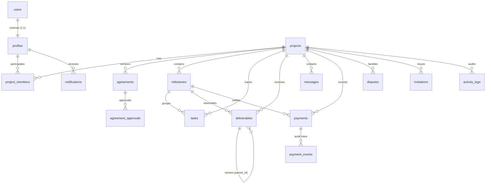

# Freelanker — Database Schema Reference

**Version:** 2.0  
**Status:** Approved Architecture  
**Database:** Supabase PostgreSQL (Postgres 15+)  
**Migration File:** `database/migrations/001_initial_schema.sql`

---

## 1. Architectural Overview

Freelanker is built around a single, normalized PostgreSQL schema hosted on Supabase. It supports the entire lifecycle of a freelance project: scoping, agreement drafting & versioning, milestone planning, deliverable review, messaging, audit trails, dispute tracking, and server-verified PayPal payments.

---

## 2. Enums

| Enum Name | Values | Description |
|-----------|--------|-------------|
| `project_member_role` | `client`, `freelancer` | Role assumed by a user for a specific project. |
| `project_status` | `draft`, `invitation_pending`, `awaiting_agreement`, `active`, `in_progress`, `under_review`, `completed`, `cancelled`, `disputed` | Complete project lifecycle states (PRD §10). |
| `agreement_status` | `draft`, `sent_for_review`, `changes_requested`, `approved`, `active`, `completed`, `cancelled` | Agreement approval and active status states. |
| `milestone_status` | `not_started`, `awaiting_prepayment`, `in_progress`, `submitted`, `under_review`, `revision_requested`, `approved`, `payment_pending`, `paid`, `disputed` | Milestone lifecycle states (PRD §10). |
| `task_status` | `todo`, `in_progress`, `done`, `cancelled` | Task execution states. |
| `invitation_status` | `pending`, `accepted`, `rejected`, `expired`, `cancelled` | Outbound invitation status. |
| `deliverable_status` | `submitted`, `under_review`, `revision_requested`, `approved`, `rejected` | Freelancer submission review states. |
| `payment_arrangement` | `upfront`, `milestone_prepayment`, `payment_after_approval` | Agreed payment arrangements (PRD §4.3). |
| `payment_status` | `pending`, `completed`, `failed`, `cancelled`, `refunded` | PayPal transaction verification states. |
| `dispute_status` | `open`, `under_review`, `awaiting_response`, `resolution_proposed`, `resolved`, `closed` | Dispute resolution lifecycle (PRD §8). |
| `activity_event_type` | `project_created`, `project_status_changed`, `agreement_created`, `agreement_version_created`, `agreement_approved`, `agreement_activated`, `milestone_created`, `milestone_status_changed`, `deliverable_submitted`, `deliverable_approved`, `deliverable_revision_requested`, `payment_initiated`, `payment_completed`, `payment_failed`, `dispute_opened`, `dispute_resolved`, `invitation_sent`, `invitation_accepted`, `invitation_rejected`, `message_sent`, `member_added` | Granular audit trail event classifications. |

---

## 3. Table Specifications

### 3.1 `profiles`
Extends `auth.users` 1:1. Holds user profile, skills, and portfolio information.
- **`id`** (`UUID`, PK): Matches `auth.users(id)`. Foreign key with `ON DELETE CASCADE`.
- **`display_name`** (`TEXT`, NOT NULL): Full name or handle.
- **`headline`** (`TEXT`): Professional headline for marketplace discovery.
- **`bio`** (`TEXT`): Detailed freelancer/client bio.
- **`avatar_url`** (`TEXT`): Image URL stored in Supabase Storage or external.
- **`skills`** (`TEXT[]`, NOT NULL, DEFAULT `{}`): Searchable skills array (indexed via GIN).
- **`portfolio_links`** (`TEXT[]`, NOT NULL, DEFAULT `{}`): Portfolio URLs.
- **`is_available`** (`BOOLEAN`, NOT NULL, DEFAULT `TRUE`): Flag for freelancer marketplace listing.
- **`is_admin`** (`BOOLEAN`, NOT NULL, DEFAULT `FALSE`): Platform admin flag. Protected from user updates and excluded from public projections.
- **`created_at`** / **`updated_at`** (`TIMESTAMPTZ`, NOT NULL, DEFAULT `now()`).

### 3.2 `projects`
Central entity holding project configuration, participants, and scope.
- **`id`** (`UUID`, PK, DEFAULT `gen_random_uuid()`).
- **`title`** (`TEXT`, NOT NULL).
- **`description`** (`TEXT`).
- **`status`** (`project_status`, NOT NULL, DEFAULT `'draft'`).
- **`initiator_id`** (`UUID`, NOT NULL, FK `profiles.id` ON DELETE RESTRICT).
- **`client_id`** (`UUID`, FK `profiles.id` ON DELETE RESTRICT): Confirmed client user.
- **`freelancer_id`** (`UUID`, FK `profiles.id` ON DELETE RESTRICT): Confirmed freelancer user.
- **`currency`** (`CHAR(3)`, NOT NULL, DEFAULT `'USD'`).
- **`total_budget`** (`NUMERIC(12,2)`, CHECK `> 0`).
- **`payment_arrangement`** (`payment_arrangement`).
- **`ai_scope_data`** (`JSONB`): Output structured JSON from OpenAI ContractFlow scoping.
- **`review_period_days`** (`INT`, NOT NULL, DEFAULT `3`, CHECK `> 0`): Standard calendar review window.
- **`created_at`** / **`updated_at`** (`TIMESTAMPTZ`, NOT NULL, DEFAULT `now()`).

### 3.3 `project_members`
Associative table supporting dual-role accounts. A user can be a client on Project A and a freelancer on Project B.
- **`id`** (`UUID`, PK, DEFAULT `gen_random_uuid()`).
- **`project_id`** (`UUID`, NOT NULL, FK `projects.id` ON DELETE CASCADE).
- **`user_id`** (`UUID`, NOT NULL, FK `profiles.id` ON DELETE CASCADE).
- **`role`** (`project_member_role`, NOT NULL).
- **`joined_at`** (`TIMESTAMPTZ`, NOT NULL, DEFAULT `now()`).
- **Constraint:** `UNIQUE(project_id, user_id)`.

### 3.4 `invitations`
Outbound invitations for unregistered or existing users to join projects.
- **`id`** (`UUID`, PK, DEFAULT `gen_random_uuid()`).
- **`project_id`** (`UUID`, NOT NULL, FK `projects.id` ON DELETE CASCADE).
- **`invited_by`** (`UUID`, NOT NULL, FK `profiles.id` ON DELETE CASCADE).
- **`invited_email`** (`TEXT`, NOT NULL).
- **`invited_user_id`** (`UUID`, FK `profiles.id` ON DELETE SET NULL).
- **`role`** (`project_member_role`, NOT NULL).
- **`status`** (`invitation_status`, NOT NULL, DEFAULT `'pending'`).
- **`token`** (`UUID`, NOT NULL, UNIQUE, DEFAULT `gen_random_uuid()`): Secret link token.
- **`message`** (`TEXT`).
- **`expires_at`** (`TIMESTAMPTZ`, NOT NULL).
- **`responded_at`** (`TIMESTAMPTZ`).
- **`created_at`** (`TIMESTAMPTZ`, NOT NULL, DEFAULT `now()`).

### 3.5 `agreements`
Formal project agreements with **versioning and snapshot preservation**.
- **`id`** (`UUID`, PK, DEFAULT `gen_random_uuid()`).
- **`project_id`** (`UUID`, NOT NULL, FK `projects.id` ON DELETE CASCADE).
- **`version_number`** (`INT`, NOT NULL, DEFAULT `1`, CHECK `>= 1`).
- **`previous_version_id`** (`UUID`, FK `agreements.id` ON DELETE RESTRICT): Tracks lineage.
- **`is_current`** (`BOOLEAN`, NOT NULL, DEFAULT `TRUE`): Only one `is_current = TRUE` per project via partial unique index.
- **`status`** (`agreement_status`, NOT NULL, DEFAULT `'draft'`).
- **`title`** (`TEXT`, NOT NULL).
- **`scope_of_work`**, **`deliverables_text`**, **`acceptance_criteria`**, **`additional_terms`** (`TEXT`).
- **`payment_arrangement`** (`payment_arrangement`, NOT NULL).
- **`total_amount`** (`NUMERIC(12,2)`, NOT NULL, CHECK `> 0`).
- **`currency`** (`CHAR(3)`, NOT NULL, DEFAULT `'USD'`).
- **`revision_limit`** (`INT`, CHECK `>= 0`).
- **`review_period_days`** (`INT`, NOT NULL, DEFAULT `3`, CHECK `> 0`).
- **`start_date`**, **`end_date`** (`DATE`).
- **`is_ai_generated`** (`BOOLEAN`, NOT NULL, DEFAULT `FALSE`).
- **`pdf_url`**, **`ai_summary`** (`TEXT`).
- **`content_snapshot`** (`JSONB`): Immutable JSON copy frozen at activation.
- **`client_approved_at`**, **`freelancer_approved_at`**, **`activated_at`**, **`superseded_at`** (`TIMESTAMPTZ`).
- **`created_by`** (`UUID`, NOT NULL, FK `profiles.id` ON DELETE RESTRICT).
- **`created_at`** / **`updated_at`** (`TIMESTAMPTZ`, NOT NULL, DEFAULT `now()`).
- **Constraints:** `UNIQUE(project_id, version_number)`, Partial UNIQUE index on `(project_id) WHERE is_current = TRUE`.

### 3.6 `agreement_approvals`
Audit trail of approvals and change requests by project participants.
- **`id`** (`UUID`, PK, DEFAULT `gen_random_uuid()`).
- **`agreement_id`** (`UUID`, NOT NULL, FK `agreements.id` ON DELETE RESTRICT).
- **`user_id`** (`UUID`, NOT NULL, FK `profiles.id` ON DELETE RESTRICT).
- **`role`** (`project_member_role`, NOT NULL).
- **`action`** (`TEXT`, NOT NULL, CHECK in `'approved'`, `'changes_requested'`, `'withdrawn'`).
- **`notes`** (`TEXT`).
- **`created_at`** (`TIMESTAMPTZ`, NOT NULL, DEFAULT `now()`).

### 3.7 `milestones`
Project milestones defining stages of work and payments.
- **`id`** (`UUID`, PK, DEFAULT `gen_random_uuid()`).
- **`project_id`** (`UUID`, NOT NULL, FK `projects.id` ON DELETE CASCADE).
- **`title`** (`TEXT`, NOT NULL).
- **`description`** (`TEXT`).
- **`status`** (`milestone_status`, NOT NULL, DEFAULT `'not_started'`).
- **`amount`** (`NUMERIC(12,2)`, NOT NULL, DEFAULT `0`, CHECK `>= 0`): Authoritative financial amount.
- **`order_index`** (`INT`, NOT NULL, DEFAULT `0`).
- **`due_date`** (`DATE`).
- **`is_ai_generated`** (`BOOLEAN`, NOT NULL, DEFAULT `FALSE`).
- **`created_at`** / **`updated_at`** (`TIMESTAMPTZ`, NOT NULL, DEFAULT `now()`).

### 3.8 `tasks`
Individual tasks under WorkBridge, optionally mapped to a milestone.
- **`id`** (`UUID`, PK, DEFAULT `gen_random_uuid()`).
- **`project_id`** (`UUID`, NOT NULL, FK `projects.id` ON DELETE CASCADE).
- **`milestone_id`** (`UUID`, FK `milestones.id` ON DELETE SET NULL).
- **`title`** (`TEXT`, NOT NULL).
- **`description`** (`TEXT`).
- **`status`** (`task_status`, NOT NULL, DEFAULT `'todo'`).
- **`assigned_to`** (`UUID`, FK `profiles.id` ON DELETE SET NULL).
- **`due_date`** (`DATE`).
- **`order_index`** (`INT`, NOT NULL, DEFAULT `0`).
- **`is_ai_generated`** (`BOOLEAN`, NOT NULL, DEFAULT `FALSE`).
- **`created_by`** (`UUID`, NOT NULL, FK `profiles.id` ON DELETE RESTRICT).
- **`created_at`** / **`updated_at`** (`TIMESTAMPTZ`, NOT NULL, DEFAULT `now()`).

### 3.9 `deliverables`
Work submissions by freelancers with revision chaining.
- **`id`** (`UUID`, PK, DEFAULT `gen_random_uuid()`).
- **`project_id`** (`UUID`, NOT NULL, FK `projects.id` ON DELETE CASCADE).
- **`milestone_id`** (`UUID`, FK `milestones.id` ON DELETE SET NULL).
- **`submitted_by`** (`UUID`, NOT NULL, FK `profiles.id` ON DELETE RESTRICT).
- **`status`** (`deliverable_status`, NOT NULL, DEFAULT `'submitted'`).
- **`title`** (`TEXT`, NOT NULL).
- **`description`**, **`submission_note`** (`TEXT`).
- **`file_urls`** (`TEXT[]`, NOT NULL, DEFAULT `{}`).
- **`link_url`** (`TEXT`).
- **`version`** (`INT`, NOT NULL, DEFAULT `1`, CHECK `>= 1`).
- **`parent_id`** (`UUID`, FK `deliverables.id` ON DELETE RESTRICT): Previous revision.
- **`review_deadline`** (`TIMESTAMPTZ`): Automatically set to `now() + (review_period_days * 1 day)`.
- **`client_feedback`** (`TEXT`).
- **`ai_analysis`** (`JSONB`): Output from OpenAI deliverable analysis.
- **`reviewed_by`** (`UUID`, FK `profiles.id` ON DELETE SET NULL).
- **`reviewed_at`** (`TIMESTAMPTZ`).
- **`created_at`** / **`updated_at`** (`TIMESTAMPTZ`, NOT NULL, DEFAULT `now()`).

### 3.10 `messages`
Project chat and AI summaries.
- **`id`** (`UUID`, PK, DEFAULT `gen_random_uuid()`).
- **`project_id`** (`UUID`, NOT NULL, FK `projects.id` ON DELETE CASCADE).
- **`sender_id`** (`UUID`, NOT NULL, FK `profiles.id` ON DELETE RESTRICT).
- **`content`** (`TEXT`, NOT NULL).
- **`file_urls`** (`TEXT[]`, NOT NULL, DEFAULT `{}`).
- **`is_ai_summary`** (`BOOLEAN`, NOT NULL, DEFAULT `FALSE`).
- **`created_at`** (`TIMESTAMPTZ`, NOT NULL, DEFAULT `now()`).

### 3.11 `payments`
Financial transaction records with server-snapshot amounts.
- **`id`** (`UUID`, PK, DEFAULT `gen_random_uuid()`).
- **`project_id`** (`UUID`, NOT NULL, FK `projects.id` ON DELETE RESTRICT).
- **`milestone_id`** (`UUID`, FK `milestones.id` ON DELETE RESTRICT): Nullable for `upfront` payments.
- **`payer_id`** (`UUID`, NOT NULL, FK `profiles.id` ON DELETE RESTRICT).
- **`payee_id`** (`UUID`, NOT NULL, FK `profiles.id` ON DELETE RESTRICT).
- **`amount_snapshot`** (`NUMERIC(12,2)`, NOT NULL, CHECK `> 0`): Fixed amount captured at payment initiation.
- **`currency_snapshot`** (`CHAR(3)`, NOT NULL, DEFAULT `'USD'`).
- **`status`** (`payment_status`, NOT NULL, DEFAULT `'pending'`).
- **`arrangement`** (`payment_arrangement`, NOT NULL).
- **`paypal_order_id`** (`TEXT`, UNIQUE).
- **`paypal_capture_id`** (`TEXT`, UNIQUE).
- **`paypal_response`** (`JSONB`): Full verified response from PayPal Capture API.
- **`initiated_at`** (`TIMESTAMPTZ`, NOT NULL, DEFAULT `now()`).
- **`completed_at`** (`TIMESTAMPTZ`).
- **`created_at`** (`TIMESTAMPTZ`, NOT NULL, DEFAULT `now()`).
- **Constraints:** `ON DELETE RESTRICT` on project and milestone; CHECK that upfront has no milestone and milestone payments require milestone.

### 3.12 `payment_events`
Append-only audit trail of payment API calls and webhook notifications.
- **`id`** (`UUID`, PK, DEFAULT `gen_random_uuid()`).
- **`payment_id`** (`UUID`, NOT NULL, FK `payments.id` ON DELETE RESTRICT).
- **`event_type`** (`TEXT`, NOT NULL).
- **`old_status`**, **`new_status`** (`payment_status`).
- **`paypal_event_id`** (`TEXT`): Indexed uniquely where not null for webhook idempotency.
- **`payload`** (`JSONB`).
- **`created_at`** (`TIMESTAMPTZ`, NOT NULL, DEFAULT `now()`).

### 3.13 `disputes`
Dispute records with resolution notes and status tracking.
- **`id`** (`UUID`, PK, DEFAULT `gen_random_uuid()`).
- **`project_id`** (`UUID`, NOT NULL, FK `projects.id` ON DELETE RESTRICT).
- **`raised_by`** (`UUID`, NOT NULL, FK `profiles.id` ON DELETE RESTRICT).
- **`against_user_id`** (`UUID`, NOT NULL, FK `profiles.id` ON DELETE RESTRICT).
- **`status`** (`dispute_status`, NOT NULL, DEFAULT `'open'`).
- **`reason`** (`TEXT`, NOT NULL), **`description`** (`TEXT`).
- **`ai_summary`** (`TEXT`), **`resolution_notes`** (`TEXT`).
- **`resolved_by`** (`UUID`, FK `profiles.id` ON DELETE SET NULL).
- **`resolved_at`** (`TIMESTAMPTZ`).
- **`created_at`** / **`updated_at`** (`TIMESTAMPTZ`, NOT NULL, DEFAULT `now()`).
- **Constraint:** `CHECK (raised_by != against_user_id)`.

### 3.14 `activity_logs`
System-wide append-only audit trail.
- **`id`** (`UUID`, PK, DEFAULT `gen_random_uuid()`).
- **`project_id`** (`UUID`, FK `projects.id` ON DELETE SET NULL).
- **`actor_id`** (`UUID`, FK `profiles.id` ON DELETE SET NULL): Null for backend automated events.
- **`event_type`** (`activity_event_type`, NOT NULL).
- **`entity_type`** (`TEXT`, NOT NULL).
- **`entity_id`** (`UUID`, NOT NULL).
- **`old_data`**, **`new_data`**, **`metadata`** (`JSONB`).
- **`created_at`** (`TIMESTAMPTZ`, NOT NULL, DEFAULT `now()`).

### 3.15 `notifications`
User notification queue.
- **`id`** (`UUID`, PK, DEFAULT `gen_random_uuid()`).
- **`user_id`** (`UUID`, NOT NULL, FK `profiles.id` ON DELETE CASCADE).
- **`project_id`** (`UUID`, FK `projects.id` ON DELETE CASCADE).
- **`type`** (`TEXT`, NOT NULL).
- **`title`** (`TEXT`, NOT NULL), **`body`** (`TEXT`).
- **`is_read`** (`BOOLEAN`, NOT NULL, DEFAULT `FALSE`).
- **`entity_type`** (`TEXT`), **`entity_id`** (`UUID`).
- **`created_at`** (`TIMESTAMPTZ`, NOT NULL, DEFAULT `now()`), **`read_at`** (`TIMESTAMPTZ`).

---

### 3.16 `public_freelancer_profiles` (View)
Safe public discovery projection for the freelancer marketplace.
- **`id`** (`UUID`): Freelancer profile identifier.
- **`display_name`**, **`headline`**, **`bio`**, **`avatar_url`** (`TEXT`).
- **`skills`**, **`portfolio_links`** (`TEXT[]`).
- **`is_available`** (`BOOLEAN`).
- **`created_at`** (`TIMESTAMPTZ`).
- **Security Properties:** `WITH (security_barrier = true)` prevents side-channel optimizer leakage; `security_invoker = false` (definer mode) ensures discovery across all available freelancers without getting blocked by `profiles` RLS; `is_admin` is omitted. SELECT granted to both `authenticated` and `anon`.

---

## 4. Integrity Triggers

1. **`trg_on_auth_user_created`**: When a user registers in `auth.users`, a default `profiles` row is automatically created with resilient `display_name` fallback (`Freelanker User`).
2. **`trg_task_milestone_same_project`**: Blocks adding a task to a milestone belonging to a different project.
3. **`trg_deliverable_integrity`**: Blocks linking a deliverable to a foreign milestone or foreign parent deliverable; automatically increments revision version.
4. **`trg_agreement_approval_member_check`**: Ensures the approving user is a member of the project with the specified role.
5. **`trg_dispute_member_check`**: Asserts both dispute participants are verified project members.
6. **`trg_agreement_immutable_after_activation`**: Blocks any modifications to all agreed terms (scope, deliverables, criteria, dates, amounts, snapshots) once an agreement is activated.
7. **`trg_set_review_deadline`**: Computes `review_deadline` using the project's `review_period_days`.
8. **`trg_set_updated_at`**: Automatically touches `updated_at` on updates across all core entities. All trigger functions execute with `SET search_path = public, pg_temp`.

