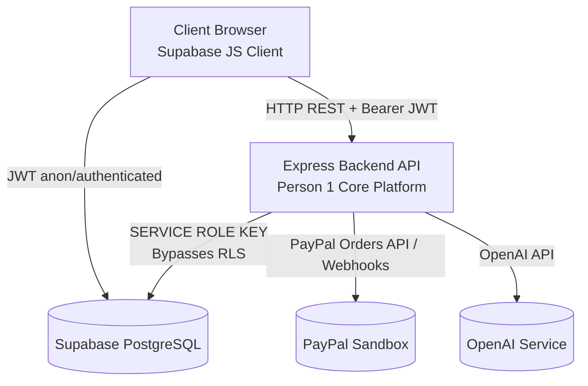

# Freelanker — Database Security & Access Control Guide

**Version:** 2.0  
**Branch:** `feature/core-platform`  
**Target:** Supabase PostgreSQL + Node.js/Express Backend  

---

## 1. Security Architecture Principles

Freelanker enforces a zero-trust model between the client browser and the database.



### Core Security Rules:
1. **Frontend uses Supabase client with user JWT**: All client-direct operations are constrained by Row Level Security (RLS) policies and column-level SQL privileges (`GRANT`/`REVOKE`).
2. **Backend uses `SUPABASE_SERVICE_ROLE_KEY`**: Privileged operations (financial state transitions, agreement activation, PayPal verification, audit writes) are strictly handled through the Express backend.
3. **No client-trusted financial values**: Neither payment amounts nor payment statuses can be supplied or modified by the browser. Amounts are snapshot from DB definitions at transaction initiation.
4. **`is_admin` is isolated**: Regular users cannot read or update `is_admin` through frontend APIs.

---

## 2. Row Level Security & Recursion Prevention

### The Recursion Problem
When an RLS policy on `projects` queries `project_members`, and an RLS policy on `project_members` queries `projects`, PostgreSQL encounters an infinite recursion loop:
```
policy on projects -> queries project_members -> triggers policy on project_members -> ...
```

### The Solution: Two-Pronged Guard
1. **Non-recursive policy on `project_members`**:
   The `project_members` SELECT policy relies strictly on `auth.uid() = user_id`. It never joins or queries another table:
   ```sql
   CREATE POLICY "project_members_select" ON public.project_members
       FOR SELECT TO authenticated
       USING (auth.uid() = user_id);
   ```

2. **`SECURITY DEFINER` Helper Functions**:
   Helper functions run with the elevated privilege of their creator, evaluating membership queries without triggering the caller's RLS policies.
   ```sql
   CREATE OR REPLACE FUNCTION public.is_project_member(p_project_id UUID, p_user_id UUID)
   RETURNS BOOLEAN
   LANGUAGE sql
   STABLE
   SECURITY DEFINER
   SET search_path = public, pg_temp
   AS $$
     SELECT EXISTS (
       SELECT 1 FROM public.project_members
       WHERE project_id = p_project_id
         AND user_id = p_user_id
     );
   $$;
   ```
   > **Security Note:** `SET search_path = public, pg_temp` is explicitly declared to prevent search path injection attacks.

---

## 3. Column-Level Security & Grants

Row Level Security controls *which rows* can be accessed. Column-level permissions control *which fields* can be read or modified.

### 3.1 `profiles` Protection
`is_admin` must never be altered or exposed to untrusted callers:
```sql
REVOKE ALL ON TABLE public.profiles FROM authenticated, anon;

-- Only safe columns granted to authenticated users:
GRANT SELECT (id, display_name, headline, bio, avatar_url, skills, portfolio_links, is_available, created_at, updated_at)
  ON TABLE public.profiles TO authenticated;

-- Users may only update presentation fields:
GRANT UPDATE (display_name, headline, bio, avatar_url, skills, portfolio_links, is_available)
  ON TABLE public.profiles TO authenticated;
```

### 3.2 Marketplace Profile View & View Security Behavior
Unauthenticated guests or authenticated users browsing the freelancer marketplace query `public_freelancer_profiles`, completely eliminating any exposure of administrative metadata (`is_admin` is omitted):

```sql
CREATE VIEW public.public_freelancer_profiles
WITH (security_barrier = true) AS
SELECT id, display_name, headline, bio, avatar_url, skills, portfolio_links, is_available, created_at
FROM public.profiles
WHERE is_available = TRUE;

GRANT SELECT ON public.public_freelancer_profiles TO authenticated, anon;
```

#### Why `security_barrier = true`?
Without `security_barrier`, the PostgreSQL query planner can push user-supplied WHERE clause functions ahead of the view's `is_available = TRUE` filter, creating potential side-channel leaks. `security_barrier = true` guarantees that the view filter executes strictly before any caller-supplied conditions.

#### Why `security_invoker` must remain `false` (Definer mode)?
In PostgreSQL 15+, views support `WITH (security_invoker = true)`. However, `public.profiles` has a strict RLS policy: `USING (auth.uid() = id)` allowing users to read only their own row. If `security_invoker = true` were enabled on `public_freelancer_profiles`, callers would only see their own profile, completely breaking marketplace discovery (and anonymous guests would see zero rows). Executing the view in definer mode (`security_invoker = false`) allows safe discovery of all available freelancers while restricting columns to non-sensitive public attributes.

### 3.3 `milestones` Financial Protection
Ordinary project members can edit task descriptions and schedules, but cannot create milestones or modify agreed milestone amounts or status flags via Supabase client:
```sql
GRANT SELECT ON TABLE public.milestones TO authenticated;
GRANT UPDATE (title, description, order_index, due_date) ON TABLE public.milestones TO authenticated;
-- Note: 'amount' and 'status' columns are NOT in the UPDATE grant list!
-- Note: 'INSERT' is NOT granted to authenticated users (milestone creation is handled exclusively via backend).
```

---

## 4. Operation Matrix: Direct Client vs. Express Backend

| Entity / Action | Client Direct (Supabase JS) | Backend Endpoint (Service Role) | Rationale |
|-----------------|:---------------------------:|:-------------------------------:|-----------|
| **Browse Freelancers** | ✅ `public_freelancer_profiles` | — | Safe public view |
| **Get User Profile** | ✅ `profiles` (Own ID only) | — | RLS self-restricted |
| **Update User Profile** | ✅ `profiles` (Safe fields) | — | Column grant enforced |
| **Create Project (Draft)** | ✅ `projects` | — | User set as `initiator_id` |
| **List User Projects** | ✅ `projects` | — | Filtered by `is_project_member` |
| **Send Invitation** | ❌ Blocked | 🔒 `POST /api/invitations` | Generates secure token, validates recipient |
| **Accept Invitation** | ❌ Blocked | 🔒 `POST /api/invitations/accept` | Atomically adds user to `project_members` |
| **Create Agreement Draft** | ❌ Blocked | 🔒 `POST /api/agreements` | Initializes versioning sequence |
| **Submit Agreement Approval** | ❌ Blocked | 🔒 `POST /api/agreements/approve` | Validates dual approval & triggers activation |
| **Amend Agreement** | ❌ Blocked | 🔒 `POST /api/agreements/amend` | Creates new version; supersedes old |
| **List Milestones** | ✅ `milestones` | — | Read-only for project members |
| **Edit Milestone Details** | ✅ `milestones` (Text only) | — | Permitted via column-level grant |
| **Create Tasks** | ✅ `tasks` | — | Validated by cross-project trigger |
| **Update Task Status** | ✅ `tasks` | — | Member authorized |
| **Submit Deliverable** | ❌ Blocked | 🔒 `POST /api/deliverables` | Enforces freelancer role & sets review deadline |
| **Approve Deliverable** | ❌ Blocked | 🔒 `POST /api/deliverables/approve`| Triggers milestone and payment progression |
| **Chat Messages** | ✅ `messages` (Send & Read) | — | Realtime enabled, member-scoped |
| **Initiate PayPal Payment** | ❌ Blocked | 🔒 `POST /api/payments/create-order` | Server reads DB milestone/upfront amount |
| **Capture PayPal Payment** | ❌ Blocked | 🔒 `POST /api/payments/capture-order`| Verifies PayPal response & sets `status='paid'` |
| **Process Webhook** | ❌ Blocked | 🔒 `POST /api/payments/webhook` | Idempotent event recorder |
| **Raise Dispute** | ✅ `disputes` (Insert) | — | Validated by member trigger |
| **Resolve Dispute** | ❌ Blocked | 🔒 Admin API | Requires platform admin verification |
| **Read Notifications** | ✅ `notifications` | — | Scoped to `auth.uid()` |

---

## 5. Testing & Verification Scenarios

### Scenario 1: Client Account
- **Action:** Selects projects where they are a member.
  - **Result:** ✅ Returns matching projects.
- **Action:** Attempts to update `milestones.status` to `'paid'` directly via Supabase client.
  - **Result:** ❌ Permission denied (column not in `GRANT UPDATE`).
- **Action:** Attempts to update `profiles.is_admin` to `TRUE`.
  - **Result:** ❌ Permission denied (column not in `GRANT UPDATE`).

### Scenario 2: Freelancer Account
- **Action:** Attempts to submit a deliverable for a project they don't belong to.
  - **Result:** ❌ RLS / FK trigger rejection.
- **Action:** Attempts to link a task to a milestone from an unrelated project.
  - **Result:** ❌ Trigger exception (`Milestone does not belong to the same project as this task`).

### Scenario 3: Unrelated User
- **Action:** Queries `SELECT * FROM projects WHERE id = 'target-id'`.
  - **Result:** ❌ Zero rows returned (RLS filtered).
- **Action:** Queries `SELECT * FROM messages WHERE project_id = 'target-id'`.
  - **Result:** ❌ Zero rows returned (RLS filtered).

### Scenario 4: Admin Operations
- Regular client JWT with `is_admin = TRUE` in database still cannot bypass RLS from the browser. Admin management tools must query the Express backend, which validates the admin status using `is_platform_admin(auth.uid())` and executes operations via the `SERVICE_ROLE_KEY`.

---

## 6. Retention and Immutability Safeguards

1. **Agreements**:
   Activated agreements cannot have their content, amounts, dates, or `activated_at` timestamp modified. Resetting `activated_at` is strictly blocked by `trg_agreement_immutable_after_activation`. Any term change requires a new record with `version_number = N + 1`.
2. **Payments & Payment Events**:
   `payments` and `payment_events` tables reject `DELETE` via `ON DELETE RESTRICT` constraints and lack any `DELETE` RLS policies.
3. **Activity Logs**:
   `activity_logs` is strictly append-only. Only the service-role can insert log entries; no updates or deletions are allowed.

